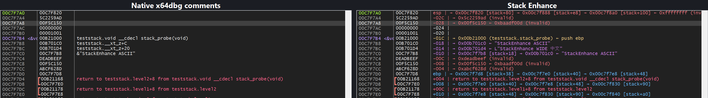
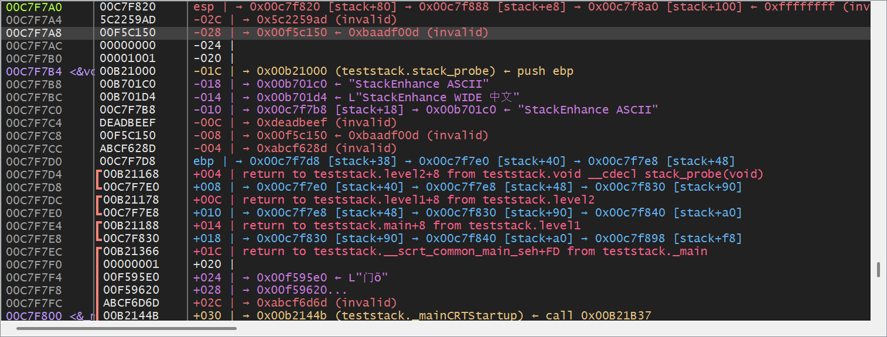

<div align="center">

# Stack Enhance

**pwndbg-style stack annotations inside x64dbg's native Stack view — no extra window.**

[](#)
[](https://x64dbg.com)
[](LICENSE)
[](https://github.com/Yuiii-owo/x64dbg-stack-enhance/releases)

[](docs/stack-before-after.png)

</div>

`Stack Enhance` is an x64dbg / x32dbg plugin that upgrades the **Comments** column of the **built-in Stack view**. It does not open a second stack window and does not replace x64dbg's layout: Address and Data stay native, while Comments gains the information you normally have to assemble by hand.

The idea is borrowed from pwndbg's stack display, but this is deliberately **not** a full clone: no `[ STACK ]` banner, no extra columns, no Qt injection. It simply makes the column x64dbg already has more useful.

## Features

- **Frame markers** — `rsp`/`rbp` (or `esp`/`ebp`) plus signed offsets from the frame pointer.
- **Code pointers** — target address, `module.function+offset`, and the instruction at the target:
  `→ 0x... (teststack.stack_probe) ← push ebp`.
- **Strings** — ASCII and UTF-16, including CJK:
  `→ 0x... ← "StackEnhance ASCII"` / `L"StackEnhance WIDE 中文"`.
- **Pointer chains** — multi-hop `→` chains, stack targets (`[stack+18]`), and cycle detection.
- **Invalid pointers** — `→ 0xdeadbeef (invalid)` in red.
- **Native annotations preserved** — `return to ... from ...` and `Pointer to SEH_Record[n]` keep their original text and colors.
- **Live** — refreshes on pause, step, and breakpoint hits; never reads memory while the target is running.
- **Toggleable** — disable the plugin and the Comments column immediately returns to native behavior.
- **x64 + x86** — two small DLLs, no Qt runtime, no changes to x64dbg's files on disk.

## Install

### From a release (recommended)

1. Download `StackEnhance.dp64` and/or `StackEnhance.dp32` from [Releases](https://github.com/Yuiii-owo/x64dbg-stack-enhance/releases).
2. Copy them into the matching plugin directories:

```text
<x64dbg>\release\x64\plugins\StackEnhance.dp64
<x64dbg>\release\x32\plugins\StackEnhance.dp32
```

3. Restart x64dbg / x32dbg (or use `Plugins → Reload`).
4. Open the native **Stack** pane. On the next pause the Comments column is enhanced.

The plugin is also available in `Plugins → Stack Enhance（栈注释增强）`.

### Build from source

Requirements:

- Visual Studio 2022 with **Desktop development with C++**.
- The x64dbg plugin SDK (`pluginsdk` from the x64dbg source tree).
- Set `X64DBG_SDK` to the SDK directory, or place it at `pluginsdk/` next to this repository.

```bat
set X64DBG_SDK=C:\path\to\x64dbg\pluginsdk
build.bat            :: x64 + x86
build.bat x64        :: x64 only
build.bat x86        :: x86 only
```

Outputs:

```text
dist/StackEnhance.dp64
dist/StackEnhance.dp32
```

`build.bat` also accepts `tests` to build the x64/x86 test targets.

## Usage

1. Debug a process as usual.
2. Open the built-in **Stack** view (the Stack pane inside the CPU tab).
3. Pause at a breakpoint or step.

The Comments column shows the annotation for each slot. The plugin menu can enable/disable the enhancement, clear the cache, or copy the current stack comments.

### Commands

```text
stackenhance on|off|toggle           enable / disable
stackenhance markers on|off          rsp/rbp/frame-offset prefix
stackenhance depth <1..8>            maximum pointer-chain hops
stackenhance strings on|off          resolve ASCII / UTF-16 strings
stackenhance disasm on|off           show the instruction at code pointers
stackenhance color on|off            color annotations by type
stackenhance clearcache              drop the comment/symbol cache
stackenhance status [path]           hookInstalled / iatSlot / original / hookCalls / loadId
stackenhance text <path>             export the current stack comments as UTF-8 text
stackenhance copy                    copy the current stack comments to the clipboard
stackenhance help                    show help
```

`stackenhance text` scans `rsp - 64*slot` through `rsp + 256*slot` by default and is useful when the Comments column is too narrow or when you want to diff two stops.

## Screenshot

[](docs/stack_x86.png)

The same Comments column is used by x64dbg: the x64 build shows `rsp`/`rbp` instead of `esp`/`ebp`. The before/after image at the top is the same x86 stack at the same breakpoint: left is x64dbg's native Comments column, right is Stack Enhance.

## How it works

x64dbg's Stack view gets its comment text from `DbgStackCommentGet(addr, STACK_COMMENT*)`, which the GUI (`x64gui.dll` / `x32gui.dll`) imports from the bridge DLL. Stack Enhance finds that import in the GUI's IAT and routes it to a small hook:

1. Call the original `DbgStackCommentGet` first, preserving `return to ...` and SEH comments.
2. Build a comment from the current `rsp`/`rbp`, the slot value, module/symbol information, strings, and disassembly.
3. Copy the text and a single row color back into the original `STACK_COMMENT`.

The IAT slot is restored on unload. If the GUI is inside the hook during unload, `plugstop` returns `false` so the host keeps the DLL loaded, avoiding a use-after-free. The plugin never writes to the target process and never patches files on disk.

## Tests

The repository includes a deterministic test target and a sandboxed end-to-end harness:

```powershell
$env:X64DBG_HOME = 'C:\path\to\x64dbg'
pwsh -File tests\run_tests.ps1
```

The harness copies x64dbg into a throwaway sandbox, runs the test target to a `__debugbreak()`, drives x64dbg through UI Automation, and checks:

- symbol resolution (`teststack.stack_probe`),
- ASCII and UTF-16 strings,
- invalid pointer `deadbeef`,
- `rsp`/`esp` and `rbp`/`ebp` markers,
- the instruction at a code pointer,
- the disabled baseline,
- unload/reload with a new `loadId`.

Generated evidence and screenshots are written to `tests/out/` (git-ignored). The test run does not touch an existing x64dbg session.

## Configuration

Settings live in the x64dbg ini under `[StackEnhance]`:

```ini
[StackEnhance]
Enabled=1
Markers=1
Depth=3
ShowStrings=1
ShowDisasm=1
Colorize=1
MaxComment=480
TextRowsAbove=64
TextRowsBelow=256
CacheTtlMs=300
```

## Limitations

- The Comments column is one line and one color per row. Per-token colors would require Qt GUI injection or rebuilding x64dbg, which this plugin deliberately avoids.
- Long comments are clipped by the native column width; resize the column or use `stackenhance text`.
- `rbp`/`ebp` is marked only when the register points into the current stack and is aligned. Optimized x64 code often uses RSP-relative frames, so you may only see the RSP marker and RSP-based offsets.
- The Comments column must be visible. Hidden columns are not drawn by x64dbg.
- Windows only; no Linux/gdb support.

## License

MIT. See [LICENSE](LICENSE).

[中文说明](README.zh-CN.md)
