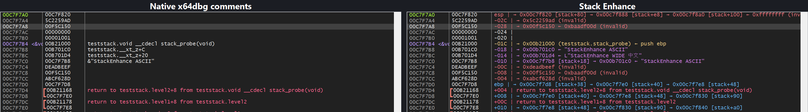
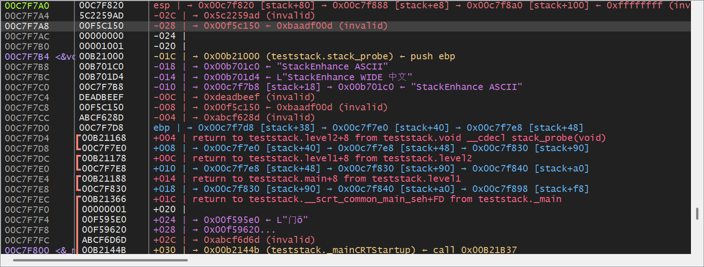

<div align="center">

# Stack Enhance（栈注释增强）

**在 x64dbg 自带 Stack 视图里显示 pwndbg 风格的栈注释，不新开窗口。**

[](#)
[](https://x64dbg.com)
[](LICENSE)

[](docs/stack-before-after.png)

</div>

`Stack Enhance` 是一个 x64dbg / x32dbg 插件，只增强**自带 Stack 视图的 Comments 列**。它不新建栈窗口、不改变原生布局，Address / Data 列保持 x64dbg 原样。

这是对 pwndbg 栈视图思路的借鉴，但**不是完整复刻**：没有 `[ STACK ]` 标题，不新增列，不注入 Qt。

## 功能

- `rsp`/`rbp`（x86 为 `esp`/`ebp`）标记和相对帧指针的偏移。
- 代码指针：目标地址、`module.function+offset` 以及目标处指令，例如
  `→ 0x... (teststack.stack_probe) ← push ebp`。
- ASCII / UTF-16 字符串（含中文）。
- 多跳指针链、栈内目标 `[stack+18]`、循环检测。
- 无效指针：`→ 0xdeadbeef (invalid)`。
- 保留原生 `return to ... from ...`、`Pointer to SEH_Record[n]` 注释和颜色。
- 暂停/单步/断点自动刷新；运行中不读取目标内存。
- 可随时禁用；禁用后 Comments 列立即恢复原生行为。
- x64/x86 双架构，无 Qt 运行时，不修改 x64dbg 磁盘文件。

## 安装

### 直接下载（推荐）

从 [Releases](https://github.com/Yuiii-owo/x64dbg-stack-enhance/releases) 下载对应 DLL，复制到：

```text
<x64dbg>\release\x64\plugins\StackEnhance.dp64
<x64dbg>\release\x32\plugins\StackEnhance.dp32
```

重启 x64dbg / x32dbg（或 `Plugins → Reload`），打开原生 **Stack** 面板即可。插件菜单位于 `Plugins → Stack Enhance（栈注释增强）`。

### 从源码构建

需要 Visual Studio 2022（Desktop development with C++）和 x64dbg 插件 SDK。

```bat
set X64DBG_SDK=C:\path\to\x64dbg\pluginsdk
build.bat            :: x64 + x86
build.bat x64        :: 仅 x64
build.bat x86        :: 仅 x86
build.bat tests      :: 构建测试目标
```

产物为 `dist/StackEnhance.dp64` / `dist/StackEnhance.dp32`。

## 使用

1. 正常调试目标。
2. 打开自带的 **Stack** 面板。
3. 在断点/单步暂停时查看 Comments 列。

### 命令

```text
stackenhance on|off|toggle
stackenhance markers on|off
stackenhance depth <1..8>
stackenhance strings on|off
stackenhance disasm on|off
stackenhance color on|off
stackenhance clearcache
stackenhance status [path]
stackenhance text <path>
stackenhance copy
stackenhance help
```

`stackenhance text` 默认扫描 `rsp - 64*slot` 到 `rsp + 256*slot`，Comments 列太窄时可导出完整文本。

## 截图

[](docs/stack_x86.png)

x64 构建使用同一套 Comments 列，只是标记为 `rsp`/`rbp`。顶部对比图是同一个 x86 栈、同一个断点：左侧是 x64dbg 原生 Comments 列，右侧是 Stack Enhance。

## 实现方式

Stack 视图通过 GUI 模块导入的 `DbgStackCommentGet(addr, STACK_COMMENT*)` 获取注释。插件在 `x64gui.dll` / `x32gui.dll` 的 IAT 中替换该导入，钩子先调用原函数保留返回地址/SEH 注释，再根据当前 `rsp`/`rbp`、槽位值、符号、字符串和反汇编生成增强注释。

卸载时恢复 IAT；如果 GUI 正在钩子内，`plugstop` 返回 `false`，让宿主保留 DLL，避免卸载竞争。插件只读目标内存，不写入，不修改磁盘文件。

## 测试

```powershell
$env:X64DBG_HOME = 'C:\path\to\x64dbg'
pwsh -File tests\run_tests.ps1
```

测试会把 x64dbg 复制到临时沙箱，运行 `tests/teststack.cpp` 到 `__debugbreak()`，通过 UI Automation 驱动 x64dbg，并验证符号、ASCII/UTF-16 字符串、`deadbeef`、`rsp`/`esp` 与 `rbp`/`ebp` 标记、代码指针指令、禁用基线以及卸载/重载。测试不影响现有调试会话；产物在 `tests/out/`（已被 git 忽略）。

## 限制

- Comments 列一行只能有一个颜色；逐 token 多色需要 Qt GUI 注入，本插件不做。
- 长注释会被原生列宽裁剪；可拖宽列或使用 `stackenhance text`。
- `rbp`/`ebp` 仅在指向当前栈且对齐时标记；x64 优化代码常使用 RSP 相对帧。
- Comments 列必须可见。
- 仅支持 Windows x64dbg/x32dbg。

## License

MIT，见 [LICENSE](LICENSE)。

[English](README.md)
